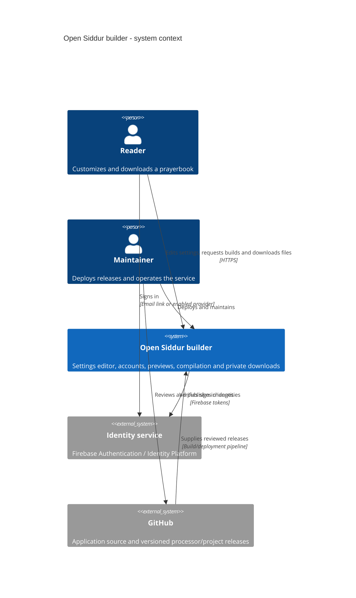
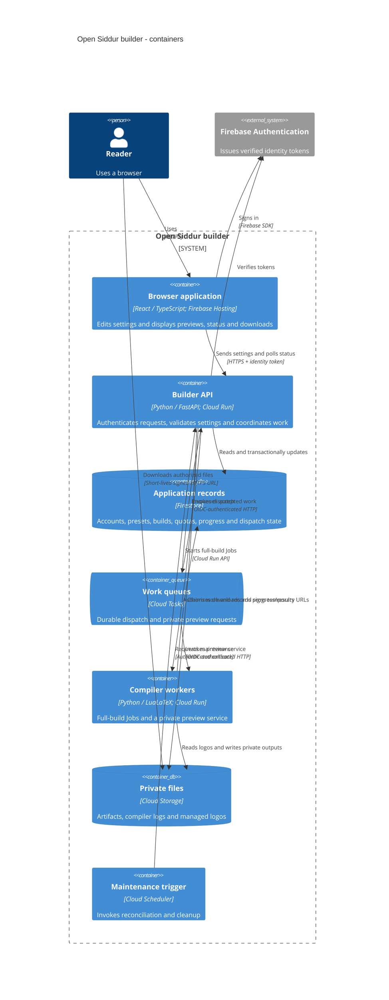
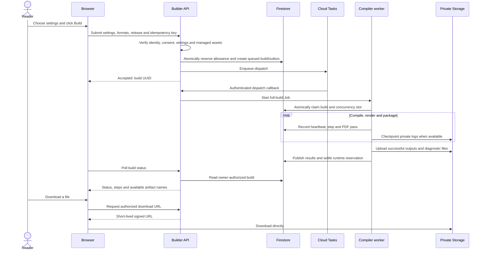
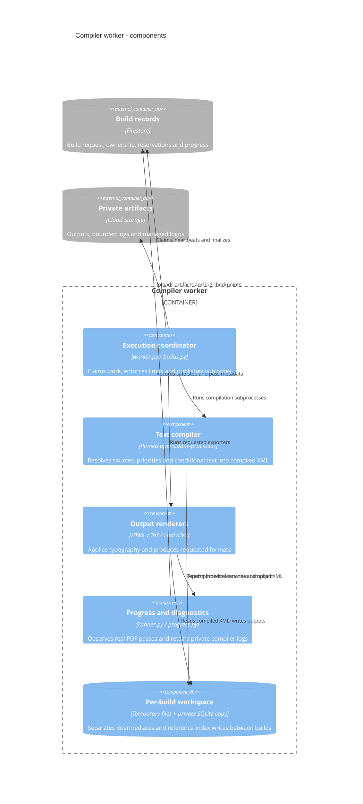

# Open Siddur builder architecture

`opensiddur-infra` is the hosted delivery layer for the Open Siddur compiler. A
reader chooses texts and settings in a browser, requests a build, and downloads a
prayerbook. Google Cloud runs the compiler when needed; the operator does not
maintain an always-on application server.

Three repositories have different responsibilities:

| Repository | Responsibility |
| --- | --- |
| `opensiddur-projects` | Cataloged source texts, translations, annotations, and published settings presets. |
| `opensiddur-processor` | Settings validation, text compilation, typography, and HTML/TeX/PDF export. |
| `opensiddur-infra` | Browser UI, accounts, consent, quotas, job orchestration, private downloads, and deployment. |

The diagrams use [C4](https://c4model.com/diagrams) to move from the whole system to
its internals. A **container** in C4 means an application or data store; it does
not necessarily mean a Docker container. The diagrams are written in
[Mermaid C4 syntax](https://mermaid.js.org/syntax/c4.html), so they remain editable
alongside the code.

## 1. System context: who uses it, and what it depends on

Readers can browse and edit without signing in. Hosted previews, full builds,
and saved presets require an account and explicit processing consent. A
maintainer operates the service and controls which software/text releases it
uses.

GitHub is a **build-time dependency**. A request does not clone the latest texts
or run arbitrary code from a repository. Each deployed compiler image contains
an explicitly pinned processor and projects snapshot, plus its schema, catalog,
fonts, reference index, and software notices.

## 2. Containers: the running applications and data stores

The logical worker application is deployed in two forms:

- **Full builds:** a Cloud Run Job with a long runtime allowance. Closing the
  browser does not stop it.
- **Previews:** a private Cloud Run HTTP service for short samples. Cloud Tasks
  invokes it; the browser cannot invoke it directly.

Firebase Hosting serves static browser files and forwards `/api/**` to the API.
The browser never connects directly to Firestore. Browser database rules deny
access; server-side services make the application’s ownership and quota decisions.

Cloud Tasks has two queues. The `builder` queue calls the API’s internal dispatch
endpoint. Dispatch starts a full Job, or creates a task in the `previews` queue
that calls the private preview service. Those callbacks use service identities,
not a reader’s sign-in token.

## 3. A build, from click to download

The request path is deliberately short. Acceptance returns a build UUID, rather
than holding an HTTP connection open for a potentially long compilation.

A preview uses the same admission and ownership rules, but dispatch routes it to
an HTTP worker instead of starting a Job.

### Acceptance is durable

The Firestore build record is also an **outbox**: it records accepted work that
still needs dispatch. If queue submission fails after the transaction commits,
the request has not vanished. Scheduled maintenance retries dispatch. Named
Cloud Tasks and a transactional worker claim prevent duplicate deliveries from
starting the compiler twice.

An idempotency key identifies one submission. Repeating the same payload/key
returns the same build; reusing the key for different settings is rejected.

### Execution can partially succeed

The worker compiles print and electronic text separately. It renders HTML before
PDF, so a PDF typesetting error can leave a useful HTML book. Each requested
format has its own result. Overall outcomes are `succeeded`, `partial`, `failed`,
or `cancelled`; unfinished work begins as `queued` and becomes `running`.

The worker checks cancellation, account availability, consent, runtime, and
output size while its subprocesses run. Cancellation terminates the process
group. Final publication is checked against current state, so a cancellation or
account deletion racing with an upload cannot publish downloadable results.

## 4. Worker components: what actually makes the book

Each run gets a fresh working directory and a copy of the prebuilt SQLite
reference database. The upstream compiler can update its index while reading;
sharing a writable index across builds would introduce contention and state
leakage.

The image also initializes the font-name index. PDF runs copy that index into a
private writable cache, so discovering fonts does not require reading unrelated
system configuration or sharing mutable caches with another run.

The image includes a versioned TeX/font stack. Generated TeX uses restricted file
access to the working directory and installed, read-only system resources, and
disables shell escape. Validated logos are staged beside the TeX and
referenced relatively, rather than requiring broader file permissions. A change
to the TeX stack or fonts can change glyph placement, bidirectional punctuation,
and pagination; visual PDF checks are therefore part of rendering verification.

Progress records contain step names and actual LuaLaTeX pass counts, not rendered
book text or guessed completion percentages. Compiler logs may contain document
text, so they are private artifacts. They are capped, checkpointed during longer
runs, and retained when a format fails. Reconciliation can preserve previously
checkpointed logs when a worker terminates unexpectedly.

## 5. Accounts, settings and authorization

Firebase Authentication currently provides verified email-link sign-in, with an
optional Google sign-in/linking flow. The API checks token validity and revocation,
then maps the identity’s issuer/subject to an **application account UUID**.
Application ownership does not depend directly on an email address or Google UID.
Additional authentication providers can be introduced through Firebase or a
future verifier adapter, while preserving application ownership mappings. An
email match alone is not an account-merging mechanism.

Settings use the pinned processor’s schema and validation rules. The UI presents
choices, numeric/text inputs and priorities, while keeping incomplete edits as
local drafts. Drafts block preview, save and build until completed or cancelled.
Uploading YAML validates before replacing the current settings. Personal presets
also remember the managed logo and display/output preferences. Saving under an
existing selected preset updates its UUID; a new name creates a new UUID.

The API verifies consent before hosted processing, saving presets or accepting
uploads. Production processing also requires App Check. Source/project choices
must come from the deployed catalog; logos use controlled PNG/JPEG upload, and
font selections must be installed. Readers cannot upload arbitrary compiler code,
XML entry points, filesystem paths or TeX programs.

### UUIDs and links serve different purposes

- A **build UUID** names a private run. Knowing it does not bypass ownership checks.
- A separate **share UUID** is a bearer capability for a deliberately shared build.
  Only its hash is stored. Sharing exposes PDF/HTML, not settings, ZIPs, source or
  logs. Enabling sharing again rotates the capability.
- A **signed download URL** grants access to one authorized object for at most
  five minutes, bounded by build expiry. Downloads go directly to Storage.

Revoking a share prevents new download URLs. A URL already issued may remain
usable until its short expiry. HTML samples are displayed without script or
same-origin privileges; downloaded HTML books are attachments.

## 6. Limits, retention and cleanup

Reservations live in Firestore transactions, not browser state or API-instance
memory. They remain consistent when Cloud Run scales horizontally. Runtime is
reserved at admission and unused time is refunded at completion.

Current defaults are defined in [builds.py](../app/opensiddur_infra/builds.py):

| Work | Per-account count per day | Maximum runtime per run | Daily runtime budget |
| --- | --- | --- | --- |
| Full book | 5 | 3 hours | 3 hours/account; 10 hours/site |
| HTML sample | 300 | 30 seconds | Shared sample budget: 20 minutes/account; 1 hour/site |
| PDF sample | 10 | 5 minutes | Shares the same sample budget as HTML |

Days follow the quota ledger’s UTC date. Each account can have one outstanding
full build and one outstanding sample. Worker claims allow two simultaneous
full builds and, independently, two samples across the site. Admission and queue
rate limits also protect the service from bursts.

| Data | Retention |
| --- | --- |
| Full-build artifacts, compiler logs and history | 30 days after completion |
| Preview artifacts/logs | At most 24 hours after completion |
| Saved presets and referenced managed logos | Until deleted |
| Unused uploads | 24 hours |
| Operational logs | 30 days; omit settings and rendered text |

Expiration is enforced by the application before access, even if physical deletion
has not run yet. Cloud Scheduler invokes maintenance to retry dispatch, reconcile
terminated executions, remove expired objects/records and clean unused assets.
Firestore TTL and Storage lifecycle rules provide additional cleanup; they are not
substitutes for authorization or immediate expiry checks. Account deletion and
consent withdrawal revoke access before asynchronous cleanup completes.

The runtime’s filesystem is temporary. Persisted application state belongs in
Firestore or private Storage, never in a particular API/worker instance.

## 7. Versions, deployment and operation

`releases.lock.json` pins the processor and projects revisions. Image assembly
creates the catalog, schema support, source index, notices and release manifest.
A content-derived release ID and immutable image digests identify the runtime;
Git commit metadata identifies the infrastructure source used to build it.

A build submission includes the catalog release it was edited against. A stale
release is rejected rather than silently compiling against different inputs.
Accepted builds retain their selected worker Job/preview-service target, so a
subsequent deployment does not redirect already accepted work to a new compiler.
Older runtime versions are retained through the deployment release map.

Terraform describes the resources. `scripts/deploy.sh` builds and verifies images,
applies the runtime configuration, publishes Hosting and enables maintenance.
GitHub Actions uses Workload Identity Federation for deployment, avoiding a
long-lived Google service-account key. The upstream workflow discovers compatible
published release pairs, verifies them in development and promotes the reviewed
lock/image combination. Runtime requests never perform that upgrade themselves.

Development and production use separate GCP projects, state and configuration.
The same architecture is instantiated per environment; production runtime exists
only after it is deployed. Public submissions are controlled separately from
whether infrastructure is provisioned. See [deployment.md](deployment.md) for
commands, rollback and launch prerequisites.

`undeploy.sh ... services` removes compute while retaining authentication, data
and deployment state. Purge and dedicated-project destruction are separate,
explicitly destructive operations. Retaining state allows recovery and audit;
stopping compute is not the same thing as deleting user data.

## 8. Where to look in the repository

| Area | Starting point |
| --- | --- |
| Browser flow, presets, previews and status | [web/src/App.tsx](../web/src/App.tsx) |
| Typed settings editor | [web/src/SchemaField.tsx](../web/src/SchemaField.tsx) |
| HTTP endpoints and access checks | [app/opensiddur_infra/api.py](../app/opensiddur_infra/api.py) |
| Identity-to-account mapping | [identity.py](../app/opensiddur_infra/identity.py) |
| Admission, state machine and quotas | [builds.py](../app/opensiddur_infra/builds.py) |
| Task dispatch | [dispatch.py](../app/opensiddur_infra/dispatch.py) |
| Compiler execution, pass observation and logs | [worker.py](../app/opensiddur_infra/worker.py), [runner.py](../app/opensiddur_infra/runner.py), [progress.py](../app/opensiddur_infra/progress.py) |
| Cleanup and recovery | [maintenance.py](../app/opensiddur_infra/maintenance.py) |
| Resource definitions | [infrastructure/](../infrastructure/) |
| Image build and upstream pins | [Dockerfile](../Dockerfile), [releases.lock.json](../releases.lock.json), [scripts/](../scripts/) |

For operational detail, continue with [deployment.md](deployment.md). For data and
licensing decisions, see [privacy.md](privacy.md) and [licensing.md](licensing.md).
[verification.md](verification.md) records what has actually been tested and
deployed; this guide describes how the system is designed to work.
